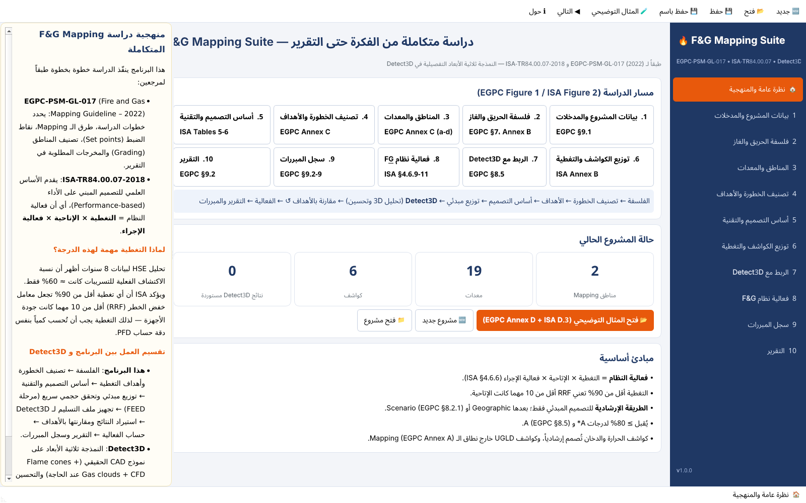
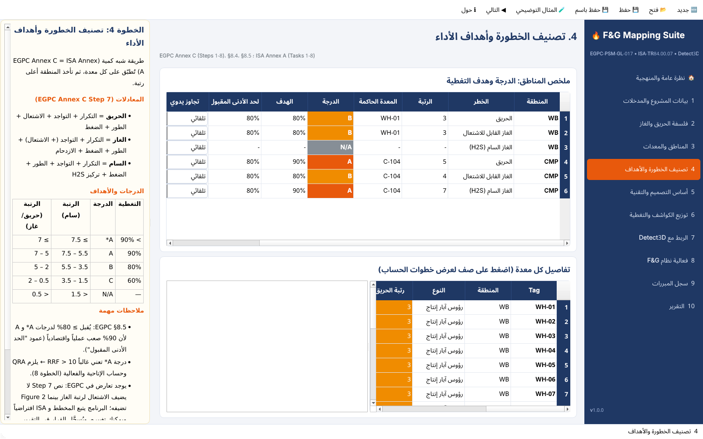
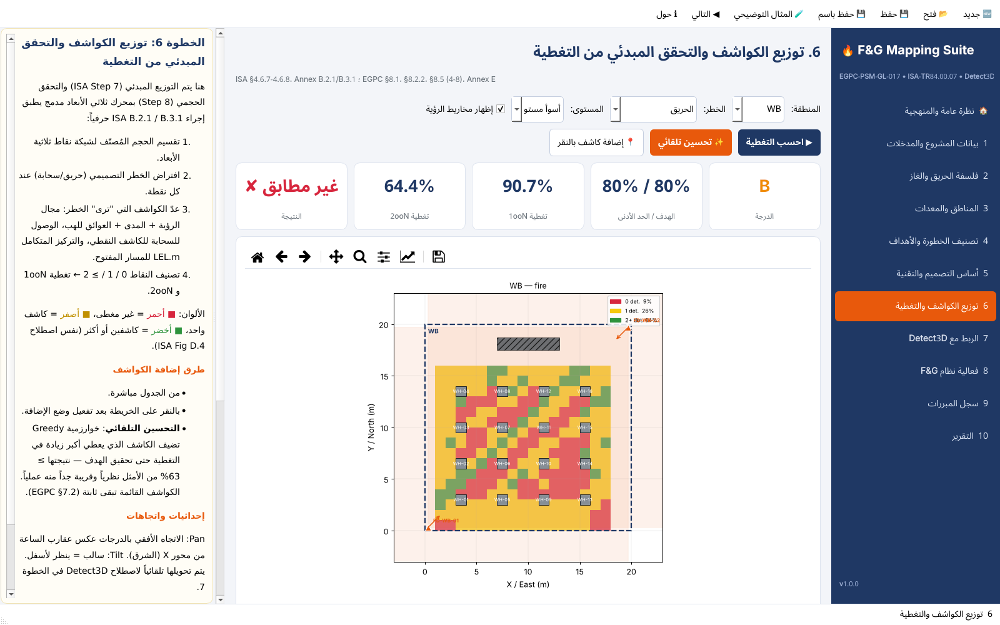

<div dir="rtl">

# 🔥 F&G Mapping Suite

برنامج Windows محمول (EXE واحد يعمل مباشرة بدون تثبيت) لأتمتة دراسة **Fire & Gas Mapping** من الفكرة حتى التقرير، طبقاً لـ:

- **EGPC-PSM-GL-017** — Fire and Gas Mapping Guideline (Rev.0, Dec-2022)
- **ISA-TR84.00.07-2018** — Guidance on the Evaluation of Fire, Combustible Gas and Toxic Gas System Effectiveness

ويعمل كشريك مكمّل لبرنامج **Detect3D** (Insight Numerics) المسؤول عن النمذجة ثلاثية الأبعاد على نموذج CAD الحقيقي.



## التحميل والتشغيل

1. من تبويب **Actions** في GitHub ← آخر تشغيل ناجح لـ *Build portable Windows EXE* ← حمّل `FG_Mapping_Suite-windows`.
   (أو من **Releases** عند إصدار tag مثل `v1.0.0`).
2. فك الضغط وشغّل `FG_Mapping_Suite.exe` مباشرة — لا يحتاج تثبيت ولا Python.
3. اضغط **«فتح المثال التوضيحي»** لاستعراض دراسة كاملة (مثال EGPC Annex D + ISA D.3).

> يحتوي الأرتيفاكت أيضاً على تقرير Word وملف تسليم Detect3D ومشروع `.fgs` تم إنتاجها آلياً من الـ EXE نفسه أثناء الـ CI (Self-test).

## خطوات الدراسة داخل البرنامج

| # | الخطوة | المرجع | المخرج |
|---|--------|--------|--------|
| 1 | بيانات المشروع ومراجعة المدخلات الـ 12 | EGPC §9.1 | قائمة المدخلات/الافتراضات |
| 2 | فلسفة الحريق والغاز، التصويت، نقاط الضبط، الطريقة | EGPC §7، §8.2-8.3، Annex B | فلسفة موثقة + تحذيرات مطابقة Table A2 |
| 3 | مناطق الـ Mapping، المعدات (مصادر التسريب)، العوائق | EGPC Annex C (a-d) | سجل المعدات + الحجم المُصنّف |
| 4 | تصنيف الخطورة شبه الكمي لكل معدة ← درجة وهدف لكل منطقة | EGPC Annex C / ISA Annex A | A*/A/B/C + هدف التغطية + سجل الحساب |
| 5 | أساس التصميم (حجم الحريق kW، قطر السحابة) واختيار التقنية | ISA Tables 5-6، EGPC Annex A | جدول قرارات مبررة |
| 6 | توزيع الكواشف + تحقق حجمي ثلاثي الأبعاد مبدئي + تحسين تلقائي | ISA Annex B.2.1/B.3.1 | خرائط 0/1/2+ وتغطية 1ooN/2ooN |
| 7 | الربط مع Detect3D: تصدير ← تحليل 3D ← استيراد ← مقارنة | EGPC §8.5 | PASS / MARGINAL / FAIL لكل منطقة |
| 8 | فعالية النظام (تغطية × إتاحية × فعالية) + تغطية السيناريوهات | ISA §4.6.9-11، Annex C-D | RRF + Event tree |
| 9 | سجل المبررات والافتراضات | EGPC §9.2 بند 9 | Justification register |
| 10 | التقرير (Word) + سجل Excel | EGPC §9.2 (11 بند) | تقرير الدراسة |

كل خطوة لها لوحة شرح بالعربي توضح: ماذا نفعل، ماذا يقول المرجع، كيف تختار، ولماذا.




## التكامل مع Detect3D

انظر [`docs/DETECT3D_INTEGRATION.md`](docs/DETECT3D_INTEGRATION.md). باختصار:

- **إلى Detect3D**: ملف Excel يحتوي `Detectors` (إحداثيات واتجاهات بعد تحويلها لإحداثيات المصنع واصطلاح الزوايا)، `Zones` (الدرجة، الهدف، حجم الحريق/السحابة لكل منطقة)، `Geometry` (صناديق المعدات للمرحلة المبدئية)، `Detect3D set-up` (خطوات الإعداد بالقيم)، وقالب `Coverage results`.
- **من Detect3D**: توزيع الكواشف النهائي (Excel/CSV)، جداول التغطية (0/1/2+ أو 1ooN/2ooN لكل منطقة)، وصور الخرائط — مع خريطة أعمدة قابلة للتعديل لأن قالب Detect3D يختلف حسب الإصدار.

## المنهجية

ملخص فهم المرجعين والفروق بينهما وكيف تم تطبيقهما: [`docs/METHODOLOGY_AR.md`](docs/METHODOLOGY_AR.md).

## حدود يجب معرفتها

- المحرك الحجمي الداخلي **للتحقق المبدئي (FEED) والتحسين**، والتحقق النهائي يكون في Detect3D على نموذج 60%/90% (ISA §5.2).
- مكتبة كواشف اللهب قيم عامة — استخدم بيانات المصنّع (المدى لحريق 1 قدم² n-Heptane، مجال الرؤية).
- أسماء أعمدة Excel واصطلاح الزوايا يجب مطابقتها مع قالب الاستيراد في نسخة Detect3D لديك (الخطوة 7 ← تعديل أسماء الأعمدة).
- النتائج تُراجع وتُعتمد من مهندس مختص.

</div>

---

## English summary

Portable single-file Windows application (PySide6) that automates a performance-based F&G mapping study per
EGPC-PSM-GL-017 and ISA-TR84.00.07-2018: philosophy → Annex C hazard ranking & coverage targets → design basis
(ISA Tables 5/6) → preliminary 3D geographic coverage (ISA Annex B procedure) with greedy optimisation →
Detect3D hand-over / result import & target verification → FGS effectiveness (coverage × availability ×
mitigation) → Word report structured per EGPC §9.2 with a full justification register.

### Run from source

```bash
pip install -r requirements.txt
python -m fgsuite            # GUI
python -m pytest -q tests    # reproduces EGPC Annex D and ISA D.2/D.3 worked examples
```

### Build the EXE locally (Windows)

```bat
pip install -r requirements.txt pyinstaller
pyinstaller --noconfirm --clean fgsuite.spec
dist\FG_Mapping_Suite.exe --selftest %TEMP%\fgs   :: headless check, exit code 0 = OK
```

CI (`.github/workflows/build-exe.yml`) builds the EXE on `windows-latest`, runs the unit tests and the frozen
self-test, and uploads the EXE plus a demo report as an artifact (and as a GitHub release on `v*` tags).
